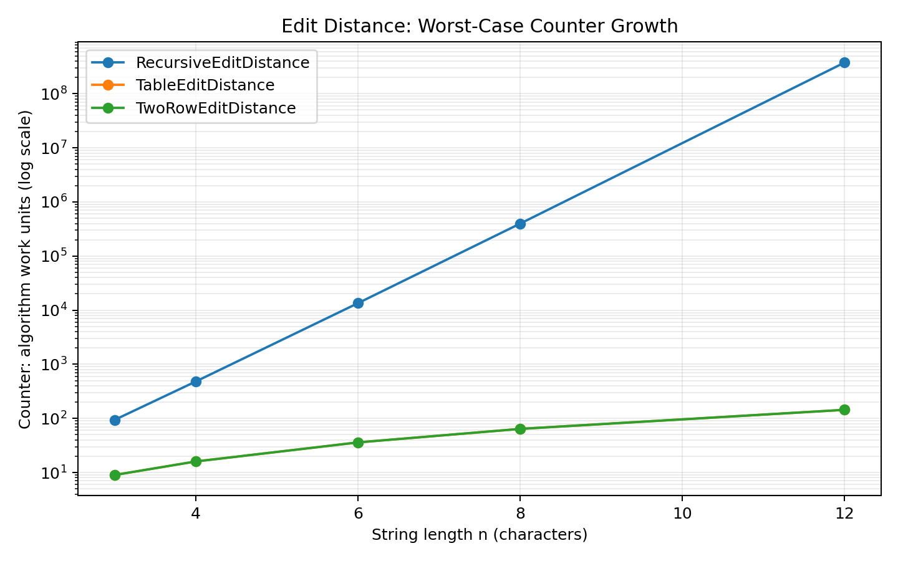
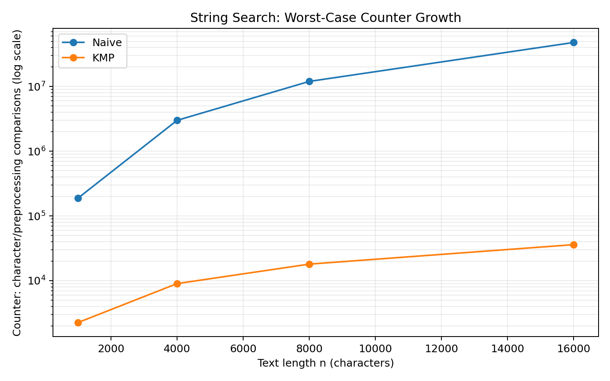
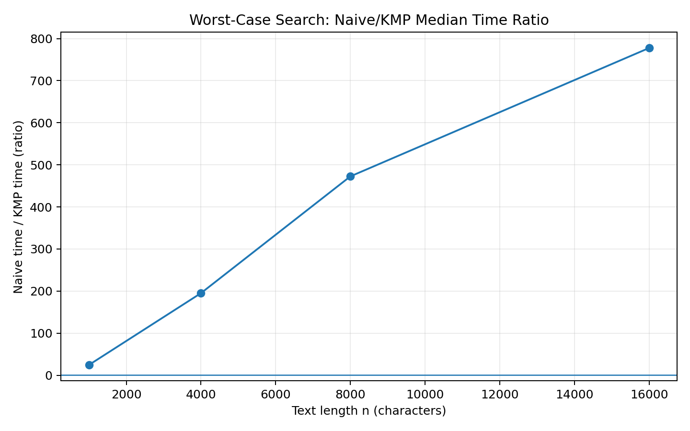

# DAA Assignment 4 — Dynamic Programming and String Algorithms

**Student:** Olzhas Zamanbekov  
**Group:** SE-2516  
**Course:** Design and Analysis of Algorithms  
**Assignment:** 4  
**Deadline:** 08.11.2026 23:59

## 1. Experiment Design Card

| Field | Decision |
|---|---|
| **Question — Edit Distance** | Does the measured work show the expected difference between plain recursion, full-table DP and two-row DP? |
| **Question — String Search** | Does KMP avoid the repeated comparisons that make Naive search slow on a deliberately difficult input? |
| **Sizes — Edit Distance** | `n = 3, 4, 6, 8, 12`. The largest is 4× the smallest. These sizes are intentionally small for recursion because its work grows very quickly. |
| **Sizes — String Search** | Text length `n = 1000, 4000, 8000, 16000`. Pattern length is `m = max(4, n/4)`. The largest text is 16× the smallest. |
| **Inputs — Edit Distance** | **random:** reproducible lowercase strings. **worst:** `a...a` versus `b...b`, so every pair of non-empty characters differs and the recursive version takes all three branches repeatedly. |
| **Inputs — String Search** | **random:** reproducible random text/pattern. **worst:** text `a...(n-1)b` and pattern `a...(m-1)b`, causing Naive search to match almost the whole pattern before failing at many starting positions. |
| **Metrics** | Median wall-clock time from 5 runs; Edit Distance counter = recursive calls or DP cells computed; Search counter = text comparisons + LPS preprocessing comparisons. |
| **Prediction** | Recursive Edit Distance will grow exponentially and become impractical quickly. Both DP versions will grow quadratically in time/work. Naive search will become quadratic on the worst input, while KMP will remain close to linear. |
| **Plots** | 1) Edit Distance worst-case counter on a log y-axis. 2) Search worst-case counter on a log y-axis. 3) Worst-case median-time ratio Naive/KMP. |

The assignment requires at least four sizes per algorithm, at least two input types per family, fixed-seed reproducibility, at least three plots, and median time over 3–5 runs. This experiment uses five runs per point and a fixed seed. The implementation follows those requirements.

## 2. Implementation Summary

### Edit Distance

All three implementations expose the same `int distance(String a, String b)` operation.

- **Recursive:** direct recursion with no memoization. A mismatch branches into deletion, insertion and replacement.
- **Table DP:** stores every subproblem in an `(n+1) × (m+1)` table, giving `O(nm)` time and `O(nm)` extra memory.
- **Two-row DP:** keeps only the previous and current rows, preserving the `O(nm)` time while reducing extra memory to `O(m)`.

The empty-string base cases are implemented, and the three versions return the same result for the required reference values.

### String Search

- **Naive:** checks every possible start position character by character.
- **KMP:** builds the public `lps(String p)` array first and uses it to avoid moving backward in the text.
- Both methods return all start indices in increasing order, including overlaps.
- An empty pattern throws `IllegalArgumentException`; a pattern longer than the text returns an empty list.

These behaviors directly match the assignment specification.

## 3. Tests and Reference Values

The required reference cases were checked:

| Case | Expected |
|---|---:|
| `distance("kitten", "sitting")` | 3 |
| `distance("flaw", "lawn")` | 2 |
| `distance("intention", "execution")` | 5 |
| `distance("", "abc")` | 3 |
| `distance("abc", "")` | 3 |
| `lps("AAACAAAA")` | `[0,1,2,0,1,2,3,3]` |
| `lps("ABABCABAB")` | `[0,0,1,2,0,1,2,3,4]` |
| search `ABABDABACDABABCABAB`, pattern `ABABCABAB` | `[10]` |
| search `AAAAA`, pattern `AA` | `[0,1,2,3]` |
| search `ABABABA`, pattern `ABA` | `[0,2,4]` |

The JUnit test suite additionally checks 100 random short-string Edit Distance cases where all three versions must agree, 100 random search cases where Naive and KMP must return the same list, overlap cases, empty-pattern exceptions and pattern-longer-than-text cases. The required reference values are specified in the assignment.

## 4. Results

### 4.1 Edit Distance — Worst Input

| n | Recursive time (ms) | Recursive counter | Table time (ms) | Table counter | Two-row time (ms) | Two-row counter |
|---:|---:|---:|---:|---:|---:|---:|
| 3 | 0.0007 | 94 | 0.0028 | 9 | 0.0027 | 9 |
| 4 | 0.0019 | 481 | 0.0039 | 16 | 0.0033 | 16 |
| 6 | 0.0422 | 13483 | 0.0075 | 36 | 0.0063 | 36 |
| 8 | 0.8954 | 398593 | 0.0106 | 64 | 0.0097 | 64 |
| 12 | 829.2164 | 377393953 | 0.0239 | 144 | 0.0202 | 144 |

The worst-case counter plot shows the key difference most clearly: the recursive counter increases explosively, while both DP counters are exactly `n²` for equal-length strings because one cell is computed for each pair of non-empty prefixes.

**Takeaway:** the recursive method reaches about 377 million recursive calls at `n=12`, while both DP implementations perform only 144 cell computations.

### 4.2 String Search — Worst Input

| n | Naive time (ms) | Naive counter | KMP time (ms) | KMP counter |
|---:|---:|---:|---:|---:|
| 1000 | 2.1085 | 187750 | 0.0859 | 2247 |
| 4000 | 5.8302 | 3001000 | 0.0299 | 8997 |
| 8000 | 25.4445 | 12002000 | 0.0539 | 17997 |
| 16000 | 85.7099 | 48004000 | 0.1102 | 35997 |

**Takeaway:** Naive search grows much faster on the constructed worst case, while KMP stays close to linear in the text size.

**Takeaway:** at the largest tested text, the median Naive/KMP time ratio is about 777.5×.

## 5. Prediction vs Result

### Edit Distance

**Prediction:** The recursive version should grow exponentially because the same subproblems are solved repeatedly. The two DP versions should have quadratic work, because each pair of prefixes is solved once.

**Result:** The prediction was confirmed. On the worst input, recursive work increased from 94 calls at `n=3` to 377,393,953 calls at `n=12`. The table and two-row methods both used 144 cell computations at `n=12`. Their counters therefore match the expected `O(n²)` behavior, while the recursive counter is dramatically larger.

### String Search

**Prediction:** The Naive algorithm should have quadratic behavior on the repeated-`a` worst-case construction, because it can compare almost the entire pattern at many starting positions. KMP should stay linear because LPS lets it reuse information instead of restarting from the beginning of the pattern.

**Result:** The prediction was confirmed. Naive search reached 48,004,000 counted comparisons at `n=16000`, while KMP used 35,997 total counted operations, including 7,997 LPS preprocessing comparisons. The gap becomes larger as the text grows.

## 6. Short Answers

### Which input made your string search slowest, and why?

The worst-case input made Naive search the slowest. The text contains a long run of `a` characters followed by `b`, and the pattern has the same structure. At many starting positions, Naive search matches almost the entire pattern before discovering the final mismatch. This causes a large number of repeated comparisons and produces the expected quadratic behavior. KMP avoids most of this repeated work by using the LPS array.

### How large an n could the recursive Edit Distance handle, and what stopped it?

In this experiment the recursive implementation was tested up to `n=12`. At that size, the worst-case input already produced 377,393,953 recursive calls and a median time of about 829 ms on the experiment machine. Increasing `n` further would make the number of calls grow extremely quickly, so the experiment would become unnecessarily expensive. The limiting factor was repeated computation of the same subproblems, not the correctness of the algorithm.

### What do you gain and what do you lose when you use two rows instead of the full table?

The main gain is memory: two rows use `O(m)` extra memory instead of `O(nm)`. The running time remains `O(nm)`, so the asymptotic time complexity is not sacrificed. The main loss is that the full DP table is no longer available for later reconstruction of the complete sequence of edit decisions without additional work. For only the edit-distance value, two rows are usually the better memory-efficient choice.

### If you had to choose one string search for your city platform, which one and why?

I would choose KMP. The city platform may search long log files and may encounter repetitive text, which can be a difficult case for Naive search. KMP has predictable linear-time search behavior and handles overlapping matches correctly. The small preprocessing cost for the LPS array is worthwhile when the text can be large.

## 7. One Paragraph on Time

The measured wall-clock times generally followed the theoretical behavior, but the counters are stronger evidence than a single timing measurement. Very small Java programs can have noisy timings because of JVM startup effects, JIT compilation, operating-system scheduling and other background activity. For that reason, each point was measured five times and the median was stored in `results.csv`. The counters are collected inside the algorithms themselves and therefore directly show how much algorithmic work was performed, independent of the speed of a particular laptop. This is especially important for the recursive Edit Distance case, where the counter grows from hundreds to hundreds of millions of calls while the DP counters remain quadratic.

## 8. Conclusion

The experiment confirms the main ideas of Dynamic Programming and KMP string matching.

1. Plain recursive Edit Distance repeatedly solves the same subproblems and becomes impractical very quickly.
2. Full-table DP removes repeated work and achieves `O(nm)` time at the cost of `O(nm)` memory.
3. Two-row DP keeps the same `O(nm)` time while reducing extra memory to `O(m)`.
4. Naive string search can become quadratic on a carefully chosen repetitive input.
5. KMP uses the LPS prefix information to avoid unnecessary re-checking and gives linear-time search after linear preprocessing.
6. Counters plus repeated median timings give a more reliable experimental explanation than one raw timing value.

## 9. Reproducibility and Deliverables

The generator uses fixed seeds, so the logical input data can be reproduced by running the same commands. The project contains:

- source code in `src/main/java`;
- JUnit 5 tests in `src/test/java`;
- `results/results.csv` with one row per run;
- three PNG plots in `results/plots/`;
- this report;
- `README.md` with build, test and experiment instructions.

The assignment asks for a Maven/Gradle project, results CSV, at least three PNG plots, a report, and a README; it also specifies the `main` branch and final tag `v1.0`.
